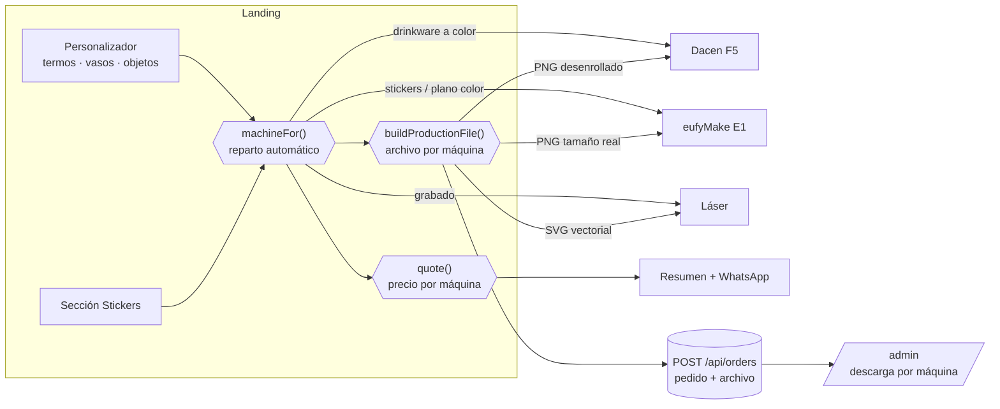
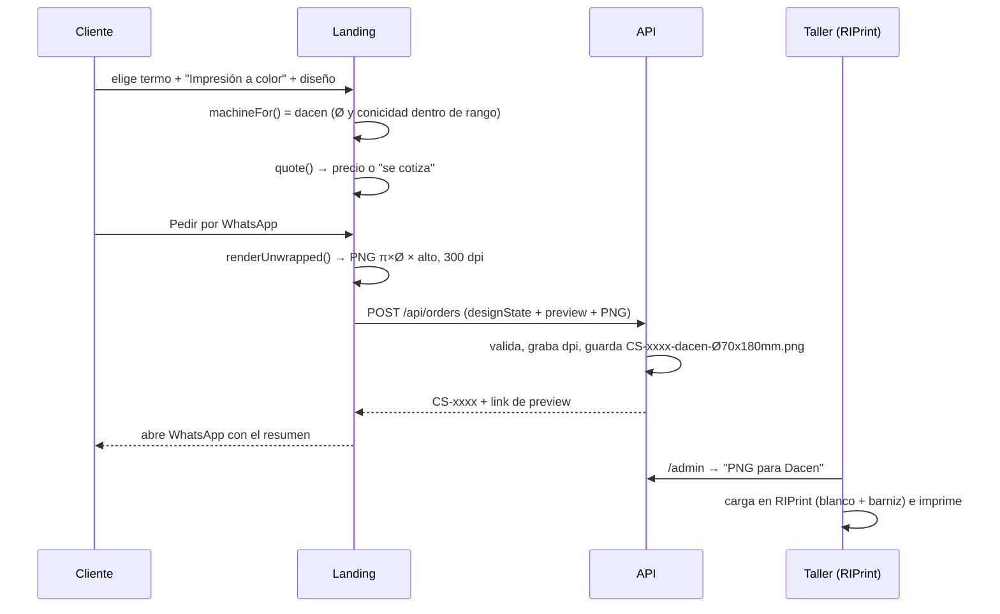

# DACEN — Plan de integración de las máquinas (Dacen F5 + eufyMake E1 + láser CO2 Willpex)

**Fecha:** 2026-10-12 · Complementa `Mejoras.md` y `PLAN-EDITOR.md`.
**Estado:** fases 1, 2 y 3 implementadas (2026-10-14), salvo el renombre `eufy` → `color` en el personalizador. Lo implementado está marcado ✅. Ver §11 para las reglas del taller confirmadas.
**Precios:** se definen después. Este plan deja la **estructura** lista para que
cargar un precio sea completar un número en un solo archivo, sin tocar
componentes.

---

## 0. Objetivo

Que cada pedido de la landing:

1. sepa **en qué máquina se produce** (láser, Dacen F5 o eufyMake E1), sin que
   el cliente tenga que elegir máquinas;
2. llegue al taller con el **archivo exacto que esa máquina necesita**, listo
   para cargar en su programa;
3. muestre un **precio calculado** cuando el precio esté definido, o "se cotiza
   por WhatsApp" mientras no lo esté;
4. quede registrado con los datos de producción (máquina, medidas, cobertura,
   cantidad) en el pedido y en `/admin`.

---

## 1. Las máquinas

| | **Dacen F5** | **eufyMake E1** | **Láser CO2 Willpex** (modelo a confirmar: 3020 / 4040 / 6040) |
|---|---|---|---|
| Qué es | UV **cilíndrica industrial**: imprime directo sobre la pieza girándola | UV de escritorio con relieve (cama plana, rotativa o film) | Grabado (fibra / diodo / CO₂) |
| Uso en el negocio | **Drinkware a color, solo piezas cilíndricas** (termos, hoppies, vasos rectos); el resto se consulta en el local | **Stickers** UV DTF ✅ · (a futuro) piezas planas a color | Grabado láser (termos con eje rotativo) |
| Límites | Ø 45–125 mm · largo 30–270 mm · cónico 0–5° · ~20–30 s/pieza | Film hasta ~33 cm de ancho · plano hasta 33×42 cm, 10 cm de alto | Según modelo |
| Tintas | CMYK + Blanco + Barniz | CMYK + Blanco + Gloss (relieve) | — |
| Programa | **RIPrint** (PNG, TIFF, PDF, JPG, EPS, AI, PSD) | **eufyMake Studio** (PNG, JPG, WebP, SVG, PSD, AI, PDF) | Diseño en **CorelDRAW** → exporta **DXF** (AutoCAD) → programa de la láser |
| Archivo que le damos | **PNG desenrollado 360°** (ancho = π × Ø), transparente, tamaño real ✅ | **PNG** transparente, tamaño real, 300 dpi ✅ | **DXF** R12 en mm ✅ (+ SVG de referencia) |

Fuentes (investigación del 2026-10-12):
- Dacen F5: https://www.dacenprinter.com/cylinder-printer/dacen-f5-uv-cylinder-printer.html
- eufyMake E1, especificaciones: https://www.eufy.com/sg-en/eufymake-spec
- eufyMake E1, formatos de importación: https://service.eufymake.com/article-description/eufyMake-UV-Printer-E1-Supported-file-import-types-and-sizes

---

## 2. Cómo funciona hoy (punto de partida)

- **Técnicas en el personalizador** (`customizer.tsx` → `TECHNIQUES`):
  - `laser` = "Grabado láser".
  - `eufy` = "Impresión UV".
  - La técnica `eufy` en realidad corresponde a la **Dacen**: es impresión directa sobre el termo. El nombre quedó de una etapa anterior.
- **Dónde se ofrece color:** `allowsColorPrint()` en `materials.ts`. Solo drinkware de acero, sin la guampa.
- **Vista 3D a color:** `engraving-maps.ts` → `makeBodyMaps({ colorPrint: true })`.
  - Pinta el diseño sobre un lienzo de `TEXTURE_W × TEXTURE_H` (1024 × 2048), que es **el cuerpo del termo desenrollado**.
  - El ancho del lienzo es la vuelta completa (`u` de 0 a 1) y el alto es la banda imprimible (`product.band`).
  - 👉 **Ese lienzo ya es, en formato, el archivo que necesita la Dacen.** Solo falta dibujarlo a tamaño real y sin el color del termo.
- **Pedido:** `POST /api/orders`.
  - Guarda `designState` (JSON libre) y la imagen de vista previa.
  - Genera un archivo de producción: SVG para láser, o PNG para stickers ✅.
- **Precio:**
  - Láser: planes fijos (`engraving-plans.ts` / Odoo `GRAB-*`).
  - UV: "se cotiza por WhatsApp".
  - Stickers: `sticker-pricing.ts`, con valores provisorios.

---

## 3. Arquitectura propuesta

### 3.1 Diagrama general



### 3.2 Flujo de un pedido a color (Dacen)



### 3.3 Piezas nuevas (estructura de código)

```
termos-landing/src/lib/
  machines.ts          ← ✅ registro de máquinas + machineFor()
  print-specs.ts       ← ✅ estructura + flag dacen; medidas en null (AJUSTAR)
  pricing.ts           ← ✅ precios de TODAS las técnicas + quote()
  production-dacen.ts  ← NUEVO: render del PNG desenrollado (reusa engraving-maps)
  sticker-pricing.ts   ← ✅ lee sus números de pricing.ts
  sticker-shape.ts     ← ✅ existe
  engraving-maps.ts    ← se extrae la capa de color a una función reutilizable

api-server/src/lib/
  production-sticker.ts ← ✅ existe; se generaliza a production-png.ts (PNG + dpi)
  production-svg.ts     ← ✅ existe (láser); lee medidas de print-specs (compartido)
```

---

## 4. Diseño de cada pieza

### 4.1 `machines.ts` — registro de máquinas ✅

```ts
export type MachineId = "laser" | "dacen" | "eufy";

export interface MachineDef {
  id: MachineId;
  name: string;            // "Dacen F5", "eufyMake E1", "Láser"
  customerLabel: string;   // lo que ve el cliente: "Impresión a color", "Grabado láser"
  fileKind: "svg" | "png-unwrapped" | "png";
  limits?: { minDiameterMm: number; maxDiameterMm: number; maxTaperDeg: number; maxLengthMm: number };
}

export const MACHINES: Record<MachineId, MachineDef> = {
  laser: { id: "laser", name: "Láser", customerLabel: "Grabado láser", fileKind: "svg" },
  dacen: {
    id: "dacen", name: "Dacen F5", customerLabel: "Impresión a color", fileKind: "png-unwrapped",
    limits: { minDiameterMm: 45, maxDiameterMm: 125, maxTaperDeg: 5, maxLengthMm: 270 },
  },
  eufy: { id: "eufy", name: "eufyMake E1", customerLabel: "Sticker / impresión a color", fileKind: "png" },
};

/** Reparto automático: el cliente elige técnica, esto elige máquina. */
export function machineFor(opts: {
  technique: "laser" | "color";
  kind: "drinkware" | "object" | "sticker";
  spec?: PrintSpec;          // de print-specs.ts
}): MachineId {
  if (opts.kind === "sticker") return "eufy";
  if (opts.technique === "laser") return "laser";
  if (opts.kind === "drinkware" && opts.spec && fitsDacen(opts.spec)) return "dacen";
  return "eufy"; // plano a color, o pieza fuera de rango de la Dacen (→ sticker/cama plana)
}
```

**Reglas:**
- El cliente **nunca** ve el nombre de la máquina. Ve la técnica.
- El nombre de la máquina va al pedido, al panel y al archivo.
- Si una pieza con color no entra en la Dacen (diámetro fuera de rango, muy cónica, manija que estorba), la alternativa es la eufy: sticker o cama plana. Eso lo decide el negocio pieza por pieza en `print-specs.ts`.
- **Renombrar `eufy` → `color`** en el personalizador:
  - `TechniqueId = "laser" | "color"`.
  - Para no romper links compartidos viejos, al leer un link se acepta también `"eufy"` (`customizer.tsx`, al aplicar el diseño compartido).

### 4.2 `print-specs.ts` — medidas físicas reales ✅ (estructura; faltan las medidas)

Hoy las medidas en mm viven en `production-svg.ts` (`PRODUCT_AREAS_MM`, marcadas "AJUSTAR") y solo cubren el frente. Pasan a un único lugar, compartido por landing y API:

```ts
export interface PrintSpec {
  /** Diámetro del cuerpo en la zona imprimible (mm). Cónico: arriba ≠ abajo. */
  diameterTopMm: number;
  diameterBottomMm: number;
  /** Alto imprimible del cuerpo, sin tapa ni base (mm). */
  printableHeightMm: number;
  /** Zona de la manija en la vuelta (u 0..1) que no se imprime; null = sin manija. */
  handleU?: [number, number] | null;
  /** Se puede imprimir a color en la Dacen (lo confirma el taller). */
  dacen: boolean;
}

// Clave: ProductId de products.ts + tamaño (sizeId), porque cada tamaño mide distinto.
export const PRINT_SPECS: Record<string, PrintSpec> = {
  // "termo-mate:termo-mate-1200": { diameterTopMm: ?, diameterBottomMm: ?, printableHeightMm: ?, handleU: null, dacen: true },
  // ... se completa con medidas reales (calibre) — ver §8
};
```

- **Conicidad:** `atan((Øtop − Øbottom) / 2 / alto)`. Si pasa de 5°, la pieza no va en la Dacen.
- **Dónde vive:** como lo usan la landing y la API, conviene un paquete compartido en `lib/` del monorepo, por ejemplo `@workspace/print-specs`. Así se termina el "MANTENER EN SINCRONÍA" que hoy tiene `production-svg.ts`.

### 4.3 Archivo desenrollado para la Dacen (`production-dacen.ts`)

**Geometría:** la textura del 3D ya es el desenrollado, así que la conversión a mm es directa.

```
x_mm = u × π × Ø            (u: 0..1 alrededor del cuerpo, igual que en designState)
y_mm = (v en la banda) × printableHeightMm
ancho del PNG = π × Ø_mm × dpi/25,4      alto = printableHeightMm × dpi/25,4
```

**Cómo se arma:**
1. Se extrae de `makeBodyMaps()` el bloque `colorPrint` a una función propia, `drawColorLayer(ctx, W, H, opts)`, que dibuja **solo el diseño**: sin color del termo, sin acabado, con fondo transparente.
   - El 3D la sigue usando como ahora.
   - La producción la llama con un lienzo grande.
2. `renderUnwrapped(opts, spec, dpi)` crea un lienzo de tamaño real (por ejemplo Ø 70 mm × 180 mm a 300 dpi ≈ 2598 × 2126 px) y llama a `drawColorLayer`.
3. El diseño se ubica en el mismo `u/v` que eligió el cliente. Un diseño en el frente queda centrado en `u = 0,5` (la mitad del archivo).
   - **Verificar con el taller dónde arranca la vuelta en la Dacen** (§8): puede que haya que correr el arte para que el frente caiga donde corresponde respecto de la costura de la pieza.
4. Mismo mecanismo que los stickers ✅:
   - El PNG viaja en el pedido (`customImage`).
   - El servidor valida y le graba los dpi (`pHYs`).
   - Se guarda como `orders/CS-xxxx-produccion.png`.
   - Se descarga como `CS-xxxx-dacen-Ø70x180mm.png`.
5. **Tamaño:** se prueba a 300 dpi y se baja si no entra en el pedido. El JSON admite 6 MB: se usan 240 o 200 dpi, igual que en stickers. Si hiciera falta 600 dpi, se cambia a subir el archivo aparte (multipart o storage), no en el JSON.

**Lo que hace RIPrint y no el archivo** (a confirmar, §8):
- La capa de **blanco**: debajo del color, para que se vea sobre termos oscuros.
- El **barniz**.
- La compensación de la **conicidad**: para piezas de 0–5°, el RIP suele hacerla. Si no la hace, el archivo se manda deformado en arco (sector de corona) y eso se agrega en `renderUnwrapped`.

**Piezas con manija:** con `handleU` se marca la franja que no se imprime.
- En el editor, el área de diseño ya excluye la manija (`engraveFaces`).
- En el archivo, esa franja queda transparente y se avisa en el panel.

### 4.4 Diseño envolvente 360° (fase posterior)

Es lo que diferencia a la Dacen: imprimir **alrededor de todo el termo**.

- Hoy existe el texto "alrededor" (`layout: "wrap360"`) y las caras frente, costados y dorso.
- **Propuesta:** en Diseño → Imagen, una opción "Cubrir todo el termo (360°)".
  - La imagen o el patrón se estira al ancho completo (π × Ø).
  - Si hace falta se repite en mosaico.
  - Respeta la franja de la manija.
- **Vista previa:** el 3D ya la muestra, porque pinta la textura completa.
- **Precio:** escalón "360°" (§4.5).
- **Aviso de calidad:** dpi efectivos = px de la imagen / (π × Ø / 25,4). Si dan menos de 150, se avisa igual que en stickers.

### 4.5 `pricing.ts` — estructura de precios única (montos a definir) ✅

Un solo archivo con los precios de **todas** las técnicas. Mientras un precio no esté definido (`null`), la landing muestra "se cotiza por WhatsApp", que es el comportamiento actual. Cuando se carga el número, aparece el precio sin tocar componentes.

```ts
export const PRICING = {
  laser: {
    // Planes actuales (engraving-plans.ts / Odoo GRAB-*): se mantienen.
  },
  dacen: {
    /** Escalones por cobertura del diseño. null = "se cotiza". */
    tiers: {
      small: null,   // logo chico o nombre (≤ X cm²)
      front: null,   // frente completo
      wrap: null,    // 360°
    } as Record<"small" | "front" | "wrap", number | null>,
    smallMaxCm2: 30,          // AJUSTAR: hasta acá es "small"
    setupPerOrder: null,      // preparación fija por pedido (se reparte por cantidad)
    qtyTiers: [],             // descuentos por cantidad (empresas), mismo formato que stickers
  },
  eufy: {
    stickers: { /* lo que hoy está en sticker-pricing.ts */ },
  },
  /** Si es false, la landing no muestra montos de esta técnica aunque existan. */
  enabled: { laser: true, dacen: false, stickers: false },
} as const;

export interface Quote {
  /** null → "se cotiza por WhatsApp". */
  total: number | null;
  unit: number | null;
  note: string;            // "Termo Gs. X + impresión a color (frente) Gs. Y"
  breakdown: { label: string; amount: number }[];
}

export function quote(input: QuoteInput): Quote { /* … */ }
```

**Cómo se calcula la cobertura para elegir el escalón** (sin pedirle nada al cliente):
- Se usa el área ocupada por el diseño en mm²: la caja de texto e imagen sobre el desenrollado, que `drawColorLayer` ya conoce.
- Hasta `smallMaxCm2` cuenta como chico.
- Si ocupa el área frontal o más, cuenta como frente.
- Si se eligió "360°", cuenta como envolvente.

**Stickers:** hoy muestran precios provisorios (`sticker-pricing.ts`). Hasta definirlos, se puede activar `enabled.stickers = false`:
- la sección mantiene el flujo completo;
- el bloque de precio dice "Te pasamos el precio por WhatsApp";
- el mensaje sale sin monto.

**Odoo (opcional, igual que el láser):** servicios con referencia interna (`UV-CHICO`, `UV-FRENTE`, `UV-360`, `STICKER-CM2`…). Si existen, pisan los números del archivo, así que el precio se cambia desde Odoo sin publicar.

### 4.6 Datos del pedido

Etapa 1, **sin migración**: todo en `designState`, como los stickers.

```jsonc
{
  "machine": "dacen",               // laser | dacen | eufy
  "technique": "color",             // lo que eligió el cliente
  "print": {
    "diameterMm": 70, "printableHeightMm": 180,
    "coverage": "front",            // small | front | wrap
    "areaCm2": 64.2,
    "dpi": 300
  },
  "quantity": 1,
  "quote": { "total": null, "unit": null, "note": "se cotiza" }
}
```

Etapa 2, cuando haga falta filtrar o sumar en el panel: columnas `machine`, `quantity`, `quote_total` y `production_kind` en `orders` (`lib/db/src/schema/orders.ts`), con `drizzle push`.

### 4.7 Panel `/admin` (etiqueta, filtro y botón por máquina ✅)

- Etiqueta de máquina en cada pedido (Láser / Dacen / eufy), con filtro por máquina para la **cola de trabajo de cada una**.
- Botón de descarga según el archivo: "SVG láser", "PNG para Dacen" o "PNG para eufyMake" ✅.
- Avisos de producción: manija, resolución baja, 360°, cantidad.
- (Futuro) estado por máquina: "en cola Dacen" → "impreso".

### 4.8 Lo que ve el cliente (cambios de diseño mínimos)

- **Técnica:** "Grabado láser" / "Impresión a color". Ya existe; cambia solo el id interno.
- Debajo de "Impresión a color":
  - con precio definido: "Precio: Gs. X (frente)";
  - sin precio: "Se cotiza según el diseño".
- Opción "360°" en Imagen (fase 3), solo en piezas con `dacen: true`.
- Si una pieza **no** admite color: el aviso actual ("este producto solo admite grabado láser").

---

## 5. Fases de implementación

| Fase | Qué | Resultado | Depende de |
|---|---|---|---|
| **1** ✅ (falta renombre en personalizador y medidas) | `machines.ts` + `print-specs.ts` (con medidas reales) + renombrar `eufy` → `color` + `machine` en el pedido y en el panel | Cada pedido dice en qué máquina va | Medidas (§8 punto 4) |
| **2** | `drawColorLayer` + `renderUnwrapped` + PNG desenrollado en el pedido + descarga "PNG para Dacen" | El taller imprime en la Dacen directo del pedido | Formato RIPrint (§8 puntos 1–3) |
| **3** ✅ | `pricing.ts` único + `quote()`; stickers y Dacen leen de ahí; `enabled` por técnica | Precio automático en cuanto se carguen montos | — (montos después) |
| **4** | Diseño 360° + aviso de dpi | Producto diferencial de la Dacen | Fase 2 |
| **5** | Columnas en `orders`, filtros por máquina, servicios de Odoo para precios | Gestión y precios desde Odoo | Fases 1–3 |

Las fases 1 y 3 se pueden hacer ya. La 2 necesita que el taller confirme el formato.

---

## 6. Archivos que se tocan (resumen)

| Archivo | Cambio |
|---|---|
| `termos-landing/src/lib/machines.ts` | Nuevo (§4.1) |
| `lib/print-specs` (paquete compartido) | Nuevo (§4.2) · reemplaza `PRODUCT_AREAS_MM` |
| `termos-landing/src/lib/production-dacen.ts` | Nuevo (§4.3) |
| `termos-landing/src/lib/engraving-maps.ts` | Extraer `drawColorLayer` del bloque `colorPrint` |
| `termos-landing/src/lib/pricing.ts` | Nuevo (§4.5) · `sticker-pricing.ts` y `engraving-plans.ts` leen de acá |
| `termos-landing/src/components/customizer.tsx` | `TechniqueId` `eufy` → `color` (acepta `eufy` en links viejos) · `machineFor` · `quote` · PNG en el pedido |
| `termos-landing/src/lib/materials.ts` | `allowsColorPrint` usa `print-specs` (`dacen: true`) |
| `api-server/src/lib/production-sticker.ts` | Generalizar a `production-png.ts` (PNG + dpi + nombre por máquina) |
| `api-server/src/routes/orders.ts` | Elegir el archivo según `designState.machine` |
| `api-server/src/routes/admin.ts` | Etiqueta y filtro de máquina, botón por tipo de archivo |
| `lib/db/src/schema/orders.ts` | (Fase 5) columnas `machine`, `quantity`, `quote_total` |

---

## 7. Riesgos y decisiones

- **Tamaño del archivo:** a 600 dpi un termo de Ø 100 × 250 mm pasa los 60 Mpx, y eso no entra en el JSON del pedido. Se arranca a 300 dpi, que suele alcanzar para UV a la distancia de uso. Si el taller pide más, se sube aparte.
- **Costura de la vuelta:** si el arte cruza el punto donde la Dacen empieza y termina la vuelta, puede quedar una línea. El editor puede marcar esa costura (opuesta al frente) y evitar ubicar diseño ahí.
- **Modelos 3D aproximados:** el 3D de algunas piezas es una forma genérica ("vista 3D aproximada"). El archivo se arma con las **medidas reales** de `print-specs`, no con las del modelo 3D, así que la producción es exacta aunque la vista sea aproximada.
- **Colores:** la pantalla no es la tinta. Se mantiene "Revisamos el diseño final con vos por WhatsApp antes de producir".

---

## 8. Preguntas para el taller (antes de la fase 2)

1. **RIPrint:** ¿qué formato cargan cómodo (PNG transparente, TIFF, PDF)? ¿El blanco y el barniz los genera el RIP o los mandamos como capa aparte? ¿A cuántos dpi trabajan (300 / 600)?
2. **Conicidad:** en vasos cónicos, ¿el RIP compensa solo o hay que mandar la imagen curvada?
3. **Arranque de la vuelta:** ¿dónde queda el "frente" de la pieza al cargarla en la Dacen (respecto de la manija, del logo Hydrate, de la costura)?
4. **Medidas reales** (calibre) de cada producto y tamaño que se imprime: Ø arriba, Ø abajo, alto imprimible y zona de la manija.
5. **Piezas con manija o correa:** ¿cuáles entran en la Dacen y cuánto ángulo queda libre?
6. **Láser:** modelo y programa (LightBurn / EzCad / xTool), para ajustar el SVG de producción.
7. **Precios** (después): escalones de la Dacen (chico / frente / 360°), stickers y descuentos por cantidad.

---

## 9. Estado de la implementación (2026-10-14)

- ✅ `src/lib/machines.ts`: `MACHINES`, `machineFor()`, `normalizeTechnique()` (acepta `"eufy"` viejo).
- ✅ `src/lib/print-specs.ts`: `PRINT_SPECS` por producto (con `bySize`), `printSpecFor()`, `fitsDacen()`, `taperDeg()`. Medidas en `null` (AJUSTAR); el flag `dacen` reproduce la regla anterior (acero, sin guampa) y `allowsColorPrint()` ya lo lee. Vive en la landing: pasar a un paquete compartido cuando la API lo necesite (fase 2).
- ✅ `src/lib/pricing.ts`: `PRICING` (láser vía engraving-plans/Odoo, Dacen por escalones en `null`, stickers), `enabled`, `quote()`. `sticker-pricing.ts` toma sus montos de acá (mismos valores).
- ✅ Pedido: `designState.machine` (la API la normaliza o la infiere en pedidos viejos: sticker → eufy, técnica `eufy`/`color` → dacen, resto → láser). Stickers mandan `machine: "eufy"`.
- ✅ `/admin`: etiqueta de máquina, filtro (Todas / Láser / Dacen F5 / eufyMake E1, `?machine=`), botón "SVG láser" / "PNG para eufyMake" / "PNG para Dacen" / "SVG referencia (Dacen)".
- Pendiente: renombre `eufy` → `color` en `customizer.tsx` y uso de `quote()` en su "Precio estimado"; fase 2 (PNG desenrollado). Mientras tanto los pedidos de la Dacen siguen generando el SVG de referencia.

---

## 10. Investigación: diseño envolvente 360° en la Dacen F5 (2026-10-14)

### Datos de la máquina

| Dato | Valor | Fuente |
|---|---|---|
| Ø imprimible | 45–125 mm (una nota dice 45–130) | [F5](https://www.dacenprinter.com/cylinder-printer/dacen-f5-uv-cylinder-printer.html), [nota F5.a](https://www.dacenprinter.com/news/the-latest-device-dacen-f5-a-cylindrical-pri-78429941.html) |
| Largo | 30–270 mm | ídem |
| Conicidad | 0–5° (Dacen pide Ø de cada punta + largo + foto para la sujeción) | FAQ F5 |
| Velocidad | "desde 20 s/pieza" (la nota dice ~30 s) | ídem |
| Cabezales | Toshiba CF3 (1–5), 600×1800 dpi, gota 3,5 pL | F5 |
| Tintas | CMYK + Blanco + Barniz (opción 8 colores) | F5 |
| Programa | RIPrint · TIFF, JPG, EPS, PDF, PNG, AI, PSD | F5 |
| 360° | "360 degrees rotary printing", clamp "zero slip for seamless 360° joints" | F5 |
| Perfil | "Automatic Profile Scanning" (mide el contorno) | F5 |
| Sin verificar | Si RIPrint compensa la conicidad, si genera el blanco solo, dpi y perfil de color, manijas, impresión en espiral | — |

**Clave:** la rotativa gira la pieza, así que cada columna del archivo es un **ángulo**. El archivo correcto es un rectángulo (vuelta × alto): el mismo espacio u/v que ya usa la textura 3D (`makeBodyMaps`). Curvar el archivo en arco (sector de corona) solo haría falta si RIPrint esperara el desarrollo plano; si no, sería una doble corrección (pregunta 1).

### Propuesta: modo "Cubrir todo el termo (360°)"

En Diseño → Imagen, solo en piezas con `fitsDacen()` y técnica a color:

- **Fondo:**
  - color liso o degradado que llena toda la banda.
- **Imagen:**
  - *Estirar* (al alto; recorta o centra a lo ancho);
  - *Mosaico* (n copias enteras);
  - *Espejo* (n par, la costura queda continua aunque el arte no sea seamless);
  - escala y corrimiento en u y v.
- **Arriba del envolvente** van el texto, el ícono y el logo de siempre.
- **Costura:** línea punteada atrás (u = 0) con el aviso "acá empieza y termina la impresión".
- **Manija:** franja rayada (`handleU`) que no se imprime.
- **Aviso de resolución:** dpi efectivos = px de la imagen ÷ (mm que ocupa / 25,4), calculado con el Ø mayor. Menos de 150 dpi advierte; menos de 100 desaconseja.

**En el código:**

- `engraving-maps.ts`: extraer el bloque `colorPrint` a `drawColorLayer(ctx, metrics, W, opts)`.
  - Orden: envolvente, después imagen y texto; al final se borra la franja de la manija.
  - El mosaico usa `createPattern` con ancho W/n, así la costura cierra exacta.
- `placement.ts`, `designState` y `design-link.ts`: campo nuevo `wrap?: { mode, repeats, scale, offsetU, offsetV, bg }`.
- `production-dacen.ts`: `renderUnwrapped(opts, spec, dpi = 300)`.
  - Lienzo de π·Ø/25,4·dpi × alto/25,4·dpi.
  - PNG con transparencia donde no hay tinta.
  - Si el taller las pide: máscaras de blanco y barniz.
- `print-specs.ts`: agregar `seamU`, `bleedMm`, `wrapAllowed`, `dpi`, `ripExpects: "angle" | "developed"`, `printStartFromRimMm` y el alto sobre la pared inclinada.
- `pricing.ts`: `coverage = "wrap"` cuando el envolvente está activo (precio `tiers.wrap`).

**Tamaño del archivo:**

| Pieza | Ancho | Px a 300 dpi | Megapíxeles |
|---|---|---|---|
| Ø 70 × 180 mm | 219,9 mm | 2598 × 2126 | 5,5 |
| Ø 90 × 200 mm | — | 3340 × 2362 | 7,9 |

Un diseño fotográfico a 360° pesa 10–20 MB en PNG y **no entra en el JSON de 6 MB del pedido**. Opciones: subirlo aparte (multipart o storage) o bajar a 200 dpi como en stickers.

**Conicidad** (solo si `ripExpects = "developed"`):

- Fórmulas:
  - generatriz s = √(h² + ((D−d)/2)²);
  - R = s·D/(D−d), r = R − s;
  - θ = π·D/R.
- Cada píxel del sector (ρ, φ) se toma de u = φ/θ + 0,5, v = (R − ρ)/s.
- Ejemplo: vaso de Ø 90/70 mm y 150 mm de alto → R ≈ 676 mm, r ≈ 526 mm, θ ≈ 23,9°.

**Fases:**

| Fase | Qué | Esfuerzo |
|---|---|---|
| 2a | `drawColorLayer` + `renderUnwrapped` + PNG en el pedido + descarga "PNG para Dacen" | 2–3 días |
| 2b | Subida aparte para archivos > 6 MB | 1 día |
| 4a | Modo 360° (fondo, estirar, mosaico, espejo, costura, manija, aviso de dpi, precio "wrap") | 3–4 días |
| 4b | Máscaras de blanco y barniz (si el RIP las pide) | 0,5–1 día |
| 4c | Curvado en arco para conos (solo si hace falta) | 1–2 días |

### Preguntas para el taller (además de las de §8)

1. ¿RIPrint toma la imagen como vuelta angular (rectángulo) o como desarrollo plano? En conos, ¿qué Ø usa para escalar? ¿Compensa la conicidad solo?
2. ¿El blanco y el barniz salen solos de la transparencia, o van como capa aparte? ¿El blanco va solo debajo del color?
3. ¿Qué formato, dpi y perfil de color prefieren?
4. ¿La F5 imprime en espiral o por pasadas? ¿Se nota la costura en un fondo liso? ¿Hace falta superposición?
5. ¿Dónde arranca la vuelta respecto del frente o de la manija? ¿Qué margen dejan arriba y abajo?
6. ¿Qué piezas con manija entran y qué ángulo queda libre?
7. Medidas con calibre por producto y tamaño (Ø de cada punta y alto sobre la pared inclinada).
8. Tiempo y costo reales de una pieza 360° a todo color, para cargar `tiers.wrap`.

---

## 11. Reglas del taller confirmadas e implementadas (2026-10-14)

**Láser CO2 Willpex → DXF ✅**
- Proceso del taller: diseño en CorelDRAW → exportar DXF (AutoCAD) → láser CO2 Willpex (con eje rotativo para termos). Willpex es una marca que se vende en Paraguay (Tupi, Todo Costura, Nissei, Top Informática): CO2 3020 (40 W, se vende con licencia "Corel Laser"), 4040 (50 W), 6040 (80 W), 1390 (100 W). Modelo exacto del taller: **a confirmar**.
- `api-server/src/lib/production-dxf.ts`: convierte el SVG de producción (texto ya en curvas, íconos vectoriales) a **DXF R12 (AC1009)**, en **mm**, Y hacia arriba. Todo va como POLYLINE cerradas (curvas y arcos en tramos de ≤ 0,1 mm); los trazos (aro de la pelota, asa del mate) pasan a su contorno con el ancho real.
- Capas: `GRABADO` (se graba), `INFO` (borde del área, pedido y avisos: apagar antes de grabar), `LOGO-VECTORIZAR` (recuadro de un logo/foto raster, que un DXF no puede llevar: vectorizar en Corel; el logo está en el SVG de referencia).
- Pedido láser: guarda `CS-xxxx-produccion.dxf` y `CS-xxxx-produccion.svg`. `/admin`: botones "DXF láser" y "SVG referencia" (`?formato=svg`).
- Verificado con ezdxf: abre sin errores ni reparaciones, unidades = mm.

**Dacen F5 → solo piezas cilíndricas ✅**
- `print-specs.ts`: `dacen: false` + `consult` en piezas con manija (`handle`: jug, vaso-sunbeam, vaso-manija, taza-manija, mini-coffee, chopera) y no cilíndricas (`shape`: copa, copa-hydrate, guampa, vaso-espresso). La landing ofrece solo láser y dice "consultá en el local o por WhatsApp" para color.
- El "termo" (Stanley con mango lateral) sigue habilitado: **confirmar con el taller** si su mango deja girar la pieza en la Dacen.

**Dacen F5 → PNG 360° para RIPrint ✅ (fase 2a)**
- `engraving-maps.ts`: `drawColorLayer()` (la capa de color que ve el 3D) extraída y compartida.
- `src/lib/production-dacen.ts`: `renderDacenPng()` dibuja la banda imprimible en un solo lienzo de tamaño final (300 dpi, baja a 240/200/150 si pasa 3,5 MB), píxeles cuadrados, fondo transparente, frente en el centro, costura en los bordes.
- Medidas: las de `print-specs.ts` si están cargadas; si no, las del modelo 3D (`printSizeApprox: true` en el pedido). Ej.: termo mate 1200 ≈ 270 × 183 mm, vaso 20 oz ≈ 267 × 107 mm.
- Viaja en `productionImage` (nuevo campo de `POST /api/orders`, límite del JSON subido a 12 MB); el server graba los dpi y lo guarda como `CS-xxxx-produccion.png`; descarga `CS-xxxx-dacen-360-270x183mm.png`.

**Stickers → PNG ✅** (ya estaba: eufyMake E1).

**Precios del grabado láser ✅**
- Nombres Gs. 35.000 · + ícono chico Gs. 40.000 · + logo Gs. 50.000 (ya estaban).
- Nuevo: **+ Gs. 5.000 por cada escritura extra** (texto en la tapa o en la base): `PRICING.laser.extraText`. Se suma en el precio estimado, el mensaje de WhatsApp y la sección Tarifas.

---

## 12. Plan: diseño que cubre todo el vaso (360°) en la Dacen F5 (2026-10-26)

Referencia: `diseño/ejemplo2.jpeg` (vaso Hydrate cónico tipo pinta).
- **Foto a sangre:** cubre toda la vuelta.
- **Encima:** logos (GR Gazoo Racing, HYDRATE), un triángulo blanco de contorno y formas rojas que siguen hacia atrás.
- **Zona de labios:** el aro de acero de arriba (~15 mm) queda sin imprimir.
- **Blanco:** se ve opaco sobre el acero, lo que indica una base de blanco.

Retoma la fase 4a (§4.4, §10). Lo que ya está y se reusa:
- `drawColorLayer()`;
- `renderDacenPng()` (vuelta completa, frente en u = 0,5, costura atrás);
- `fitsDacen()`;
- el escalón `PRICING.dacen.tiers.wrap`.

### 12.1 Dos caminos para el cliente

- **A. "Subí tu diseño completo"** (empresas y diseñadores).
  - El cliente descarga una plantilla por vaso y talle: PNG y PDF a tamaño real, con zona segura, sangrado, costura y zona de labios marcadas.
  - Arma el arte afuera (Canva, Illustrator) y lo sube.
  - Es la opción de más valor y menos esfuerzo.
- **B. "Armalo acá"**:
  - fondo 360°: foto, color o degradado;
  - encima, el texto, ícono o logo de siempre;
  - más adelante, varios logos.

### 12.2 Modelo de datos

```ts
interface DesignWrap {
  kind: "image" | "color" | "gradient" | "artwork"; // artwork = arte 360° completo subido
  src?: string;
  colors?: string[];
  fit: "cover" | "stretch" | "tile" | "mirror";
  repeats?: number;                // mosaico / espejo (espejo con n par: costura continua)
  scale: number; offsetU: number; offsetV: number;
}
// estado del diseño: wrap?: DesignWrap; overlays?: ArtLayer[]  (fase 4: varios logos)
```

Va en `placement.ts`, en el `designState` y en `design-link.ts`.

### 12.3 Geometría (`print-specs.ts`, por vaso y talle)

- **Tamaño del archivo:** ancho = π × Ø; alto = alto imprimible. Es el mismo espacio u/v que la textura del 3D.
- **Campos nuevos:**
  - `lipZoneMm`;
  - `bottomMarginMm`;
  - `bleedMm` (~2 mm);
  - `seamOverlapMm`;
  - `ripExpects: "angle" | "developed"`;
  - `wrapAllowed`.
- **Cónicos:** si RIPrint espera el desarrollo plano, el PNG se curva en arco (fórmulas en §10).

### 12.4 Dibujo (`drawColorLayer`)

Orden: **fondo 360°** → **logos/imágenes** → **textos**.

- **Fondo en mosaico:** se dibuja con `createPattern` de ancho W/n, así la costura cierra exacta.
- **Al final:** se borran la zona de labios, los márgenes y la franja de la manija (`handleU`).
- **Vista 3D:** con el fondo activo, la textura pasa de 1024 a 2048 px de ancho. Hay que probarlo en celulares de gama baja.
- **Producción:** usa la imagen original en alta resolución.

### 12.5 Editor móvil

- **Opción nueva:** "Todo el vaso (360°)" en "Agregá tu diseño". Solo aparece con impresión a color y `fitsDacen()`.
- **Controles:**
  - modos Ajustar / Mosaico / Espejo;
  - arrastrar para mover y pellizcar para hacer zoom.
- **"Ver desplegado":** muestra el rectángulo plano con la costura punteada, la zona de labios y la manija.
- **Aviso de resolución:**
  - dpi efectivos = px de ancho ÷ (π × Ø ÷ 25,4).
  - < 150 dpi: advierte. < 100 dpi: desaconseja.
  - Ejemplo: Ø 85 mm necesita ~3150 px para 300 dpi y ~1600 px para 150 dpi.

### 12.6 Pedido, archivo y panel

- **Archivo:** hoy `renderDacenPng` baja hasta 150 dpi para que el PNG entre en el pedido, y una foto 360° pesa 10–20 MB.
  - Se sube aparte (multipart o storage) y se mantiene en 300 dpi fijos.
  - Máscara `-blanco.png` aparte, solo si RIPrint no arma el blanco desde la transparencia.
- **Pedido:** `print.coverage = "wrap"`, más `wrap` con la fuente y los dpi efectivos.
- **`/admin`:** avisos "360°", "baja resolución" y "medidas aproximadas".

### 12.7 Fases

| Fase | Qué | Esfuerzo | Depende de |
|---|---|---|---|
| 0 | Medidas con calibre de los vasos y respuestas del taller (12.8) | — | Negocio |
| 1 | Plantilla descargable + "Subí tu diseño completo" + aviso de dpi | 2 días | 0 |
| 2 | Subida aparte de archivos grandes (300 dpi fijos) | 1 día | — |
| 3 | Fondo 360° en el editor + "Ver desplegado" | 3–4 días | 2 |
| 4 | Varios logos encima del fondo | 2–3 días | 3 |
| 5 | Máscaras de blanco y barniz, curvado en arco para conos (si RIPrint los pide) | 1–3 días | 12.8 |

### 12.8 Preguntas para el taller

1. **Cónicos:** ¿RIPrint toma rectángulo o hay que mandarlo curvado? ¿Con qué Ø escala?
2. **Blanco:** ¿lo genera RIPrint o va en una capa aparte? ¿Debajo de todo?
3. **Costura:** ¿cuánta superposición hace falta? ¿Se nota en fondo liso o en foto?
4. **Márgenes:** ¿cuántos mm de labios arriba y de margen abajo?
5. **Archivo:** ¿qué dpi, qué formato (PNG o TIFF) y qué perfil de color?
6. **Primeros vasos:** ¿con cuáles arrancamos? Propuesta: `vaso` y `vaso-hydrate`.

### 12.9 Estado de la implementación (2026-10-26)

**Hecho ✅ (fases 1, 2 y 3; las medidas siguen siendo las del modelo 3D)**

- **Dibujo del fondo:** `src/lib/wrap-design.ts`.
  - `WrapDesign` / `WrapLayer`.
  - `drawWrapLayer()`, con los modos Ajustar (zoom y corrimiento), Mosaico (3 copias), Espejo (2) y Arte completo (de borde a borde).
  - `wrapEffectiveDpi()`, `dpiVerdict()` y `artworkDistortion()`.
- **`drawColorLayer`:** dibuja primero el fondo y encima el logo o ícono y los textos. El 3D (`thermos-3d.tsx`, prop `wrap`), el desplegado y el archivo usan la misma función.
- **Archivo para la Dacen:** primero salía en JPEG; con las respuestas del taller pasó a PNG + vector (ver 12.10). El server todavía acepta JPEG por si queda algún pedido de esa versión.
- **Editor:** `src/components/wrap-design-panel.tsx`.
  - Subida de la imagen; una imagen con la proporción de la plantilla entra directo como «Arte completo».
  - Modos, aviso de resolución y aviso de deformación.
  - «Ver desplegado» (`UnwrappedDialog`) y «Descargar plantilla» (PNG a 300 dpi con frente, costura y zona segura).
  - Aparece en la hoja «Agregar» del celular («Todo el vaso (360°)») y en la pestaña Imagen de escritorio, solo con impresión a color en piezas que pasan `fitsDacen()`.
- **Pedido:**
  - `designState.coverage = "wrap"`;
  - `designState.wrap` con modo, zoom, corrimiento, tamaño de la imagen y dpi efectivos;
  - `productionFormat`;
  - renglón «Diseño: Todo el vaso (360°)»;
  - `quote()` con `coverage: "wrap"`.
- **3D:** con fondo 360° se oculta el logo del modelo, porque el fondo lo tapa.

**Pendiente**

- **Fase 0:** medidas de calibre (`print-specs.ts`) y las respuestas del taller (12.8). Los campos `lipZoneMm`, `bleedMm` y `seamOverlapMm` se agregan cuando estén.
- ~~Fase 4~~: hecha (12.10).
- ~~Fase 5~~: no hace falta (12.10).
- **Link compartido:** no lleva la imagen del fondo; tampoco lleva el logo.

### 12.10 Respuestas del taller y fase 4 (2026-10-26)

**Lo que respondió el taller**

1. **Vasos cónicos:** el archivo rectangular sirve. No se curva en arco.
2. **Blanco:** el programa de la máquina (el taller lo llama «riin») genera solo la base blanca. No mandamos máscaras.
3. **Costura:** la superposición varía según el vaso y la ajusta el operario.
4. **Márgenes:** se manda el original según la medida del vaso. El operario ajusta y configura el resto en la máquina.
5. **Formato:** la imagen en PNG de alta calidad, y los logos y textos en vector.
6. **Medidas:** solo necesita el **alto** y el **diámetro de la base** de cada vaso.

**Qué cambió**

- **Fase 5 descartada:** no hay capa de blanco ni barniz, ni curvado en arco.
- **Medidas:** `dacenPrintSize` usa el Ø de la base (`diameterBottomMm`) y el alto (`printableHeightMm`). Falta cargarlos con calibre en `print-specs.ts`.
- **Archivo** (`production-dacen.ts`): `renderDacenPng` vuelve a PNG, hasta 11,5 MB y 300 dpi.
  - El PNG lleva solo lo raster: el fondo 360°, las fotos y los logos PNG/JPG.
  - Los textos, el ícono de la galería y los logos SVG no se pintan en el PNG. `drawColorLayer` los anota con su transformación exacta (`lib/vector-marks.ts`, `vectorSink`).
  - Viajan en `productionVectors`, un campo nuevo de `POST /api/orders`.
- **Server** (`production-dacen-svg.ts`): arma `CS-xxxx-produccion-vector.svg` a tamaño real en mm, con tres capas:
  - **IMAGEN:** el PNG embebido.
  - **LOGOS:** íconos y SVG del cliente, sin scripts, eventos ni referencias externas.
  - **TEXTOS:** convertidos a curvas con la tipografía de producción.
  - Además guarda el PNG solo en `-produccion.png`.
  - `/admin` muestra «SVG vectorial 360° (Dacen)» y «PNG imagen (Dacen)».
  - El SVG se abre en Corel o Illustrator para exportar a lo que pida la máquina.
- **Límites:** el JSON admite 32 MB y el PNG de la Dacen hasta 12 MB. Si el archivo pasa de 4 MB, el pedido espera hasta 2 minutos.
- **Fase 4, varios logos sobre el fondo** (`WrapDesign.logos`, hasta 4):
  - Cada logo se ubica por cara (Frente / Izquierda / Atrás / Derecha), con su alto y su tamaño, desde el panel «Todo el vaso (360°)».
  - Se dibujan sobre el fondo en el 3D, en el desplegado y en el archivo.
  - En SVG van en vector; en PNG o JPG, dentro del PNG.
  - Cambiar el fondo no borra los logos.
- **Caras en el desplegado y la plantilla:** se corrigieron para coincidir con `face-area.ts` (izquierda en u = 0,75).

**Pendiente**

- **Medidas con calibre:** alto y Ø de la base de cada vaso y talle.
- **Prueba en la máquina:** imprimir un vaso con un pedido real (PNG + SVG).
- **Monto del escalón 360°:** `PRICING.dacen.tiers.wrap`.

### 12.11 Corrección: el fondo cubre el cuerpo entero (2026-10-26)

- **Problema** (`diseño/bug2.png`): el fondo 360° llenaba solo la banda grabable. Arriba y abajo quedaba el color de la pieza, por ejemplo el amarillo del vaso de 473 ml.
- **Corrección:** `bodyMetrics()` (`engraving-maps.ts`) da el cuerpo pintado completo (v 0..1, sobre la longitud de arco del perfil). El fondo, el archivo de la Dacen, el desplegado y la plantilla usan ese alto en cada modelo y tamaño.
  - Los textos y logos siguen limitados a la banda, que queda como zona segura.
  - Sin medidas de calibre, el alto del archivo es la pared del cuerpo medida sobre el modelo 3D.
- **Tour** (`diseño/bug.png`): el paso «Girá el termo» iluminaba un recuadro fijo. Ahora el visor 3D mide la silueta real de la pieza (`screenBoundsRef`, que proyecta los vértices del modelo) y el spotlight se ajusta a cada producto y tamaño.
